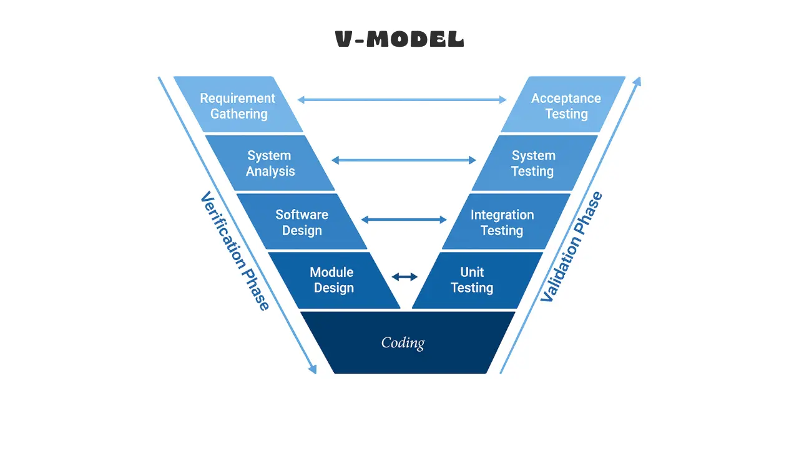
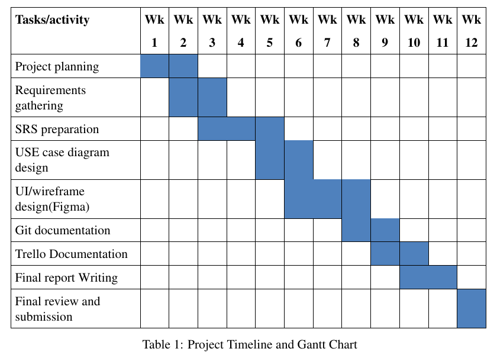
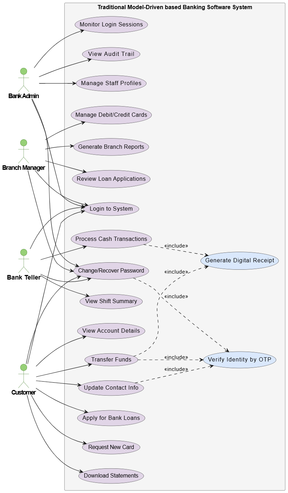
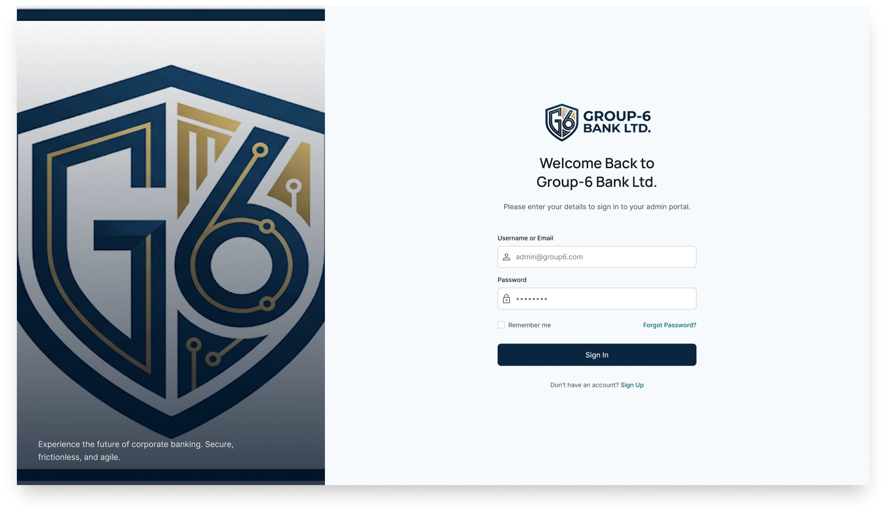
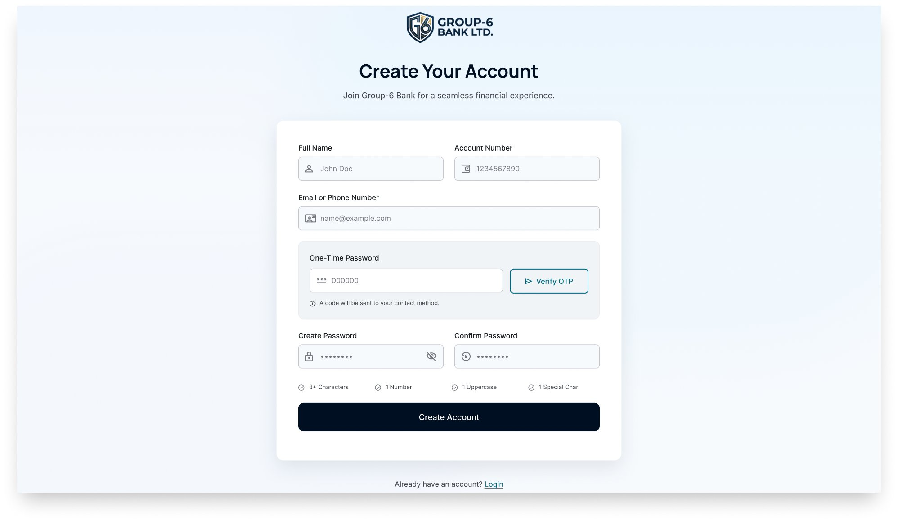
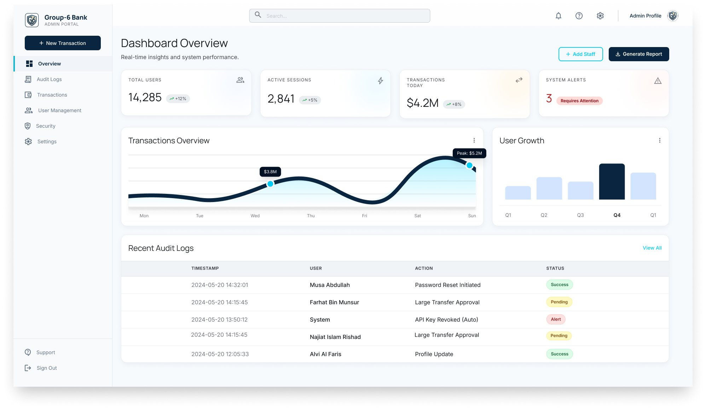
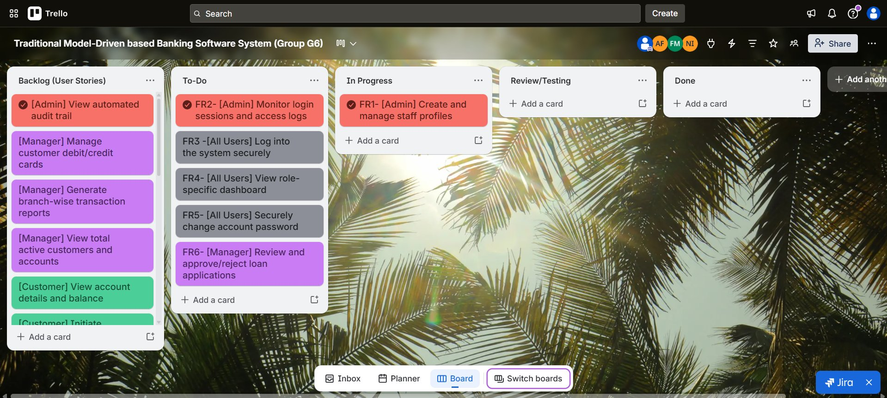

# Traditional Model-Driven Banking Software System

A software engineering project report for a role-based banking system, planned with the **V-Model**.
It covers the project proposal, timeline, SRS (scopes, user stories, traceability matrix),
use case diagram, Figma wireframes and the Git / Trello workflow.

Software Engineering project, AIUB – Spring 25-26, Section A, Group G6.

> This repository contains the **project report only** (no source code).

**Semester:** Spring 2025-2026

## Report

[SoftwareProjectReport.pdf](SoftwareProjectReport.pdf) – 42 pages, written in LaTeX.

## Contents of the Report

1. **Project Proposal** – background of the problem and why the V-Model was chosen.
2. **Timeline / Gantt Chart** – 12-week plan.
3. **Software Requirements Specification (SRS)** – scopes and features, user story table, functional and non-functional requirements traceability matrix.
4. **Software Design** – use case diagram and UI wireframes made in Figma.
5. **Git Workflow** – feature branches, commits and merges of every module, with the Trello board.
6. **Conclusion**

## Users of the System

- **Bank Administrator** – manages staff profiles, monitors login sessions and views the audit trail.
- **Branch Manager** – reviews loan applications, manages debit/credit cards and generates branch reports.
- **Bank Teller** – processes cash deposits and withdrawals and views the daily shift summary.
- **Customer** – views balance, updates contact info, transfers funds, applies for loans, requests cards and downloads statements.

## Features

- Role-based login, dashboards, password change and OTP-based recovery.
- Customer online registration with account number and OTP.
- Cash deposit / withdrawal, internal and external fund transfer with digital receipt.
- Loan applications with approve / reject and status tracking.
- Debit / credit card requests, issue, activate and block.
- Monthly statements, teller shift summary, branch reports and audit trail.

## Tools Used

- **LaTeX** – report
- **Figma** – UI / wireframe design
- **UML** – use case diagram
- **Git & GitHub** – version control
- **Trello** – task management

## Clone the Project

```bash
git clone https://github.com/munshi-rishad/Software-Traditional-Model-Driven-Banking-System.git
```

Then open `SoftwareProjectReport.pdf` with any PDF reader.

## Team (Group G6)

- Musa Abdullah – 22-49674-3
- Farhat Bin Munsur – 24-56328-1
- Najiat Islam Rishad – 23-55218-3
- Alvi Al Faris – 23-51449-1

## Screenshots

### 1. V-Model Process

The SDLC model of the project. Every development phase has a matching testing phase.

<p align="center">
  
</p>

### 2. Gantt Chart

12-week timeline from project planning to final submission.

<p align="center">
  
</p>

### 3. Use Case Diagram

Bank Admin, Branch Manager, Bank Teller and Customer with their use cases.

<p align="center">
  
</p>

### 4. Login Wireframe

Figma design of the secure login screen.

<p align="center">
  
</p>

### 5. Sign Up Wireframe

Figma design of the customer registration screen.

<p align="center">
  
</p>

### 6. Admin Dashboard Wireframe

Figma design of the admin panel with users, sessions, transactions and audit logs.

<p align="center">
  
</p>

### 7. Trello Board

User stories moved through Backlog, To-Do, In Progress, Review/Testing and Done.

<p align="center">
  
</p>
